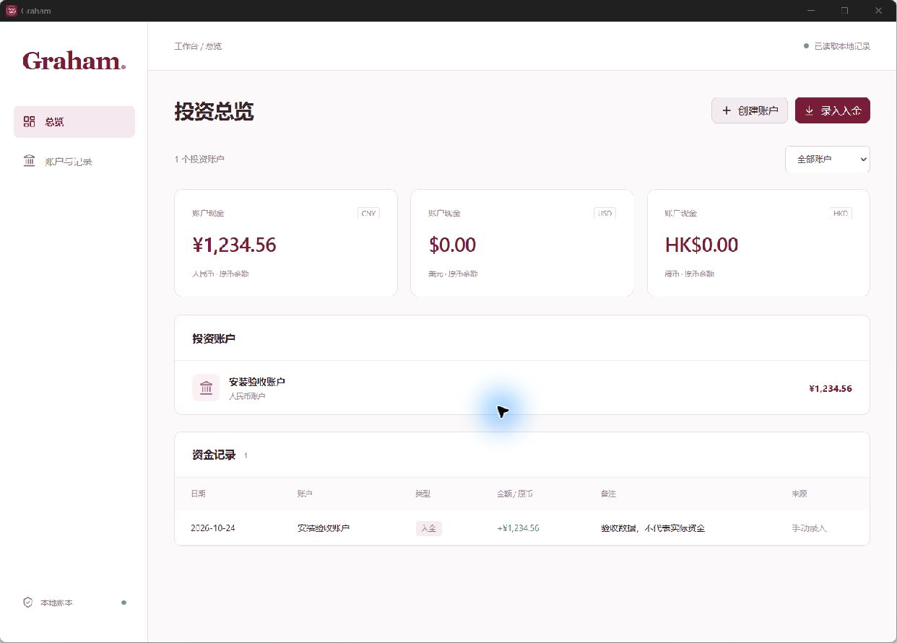
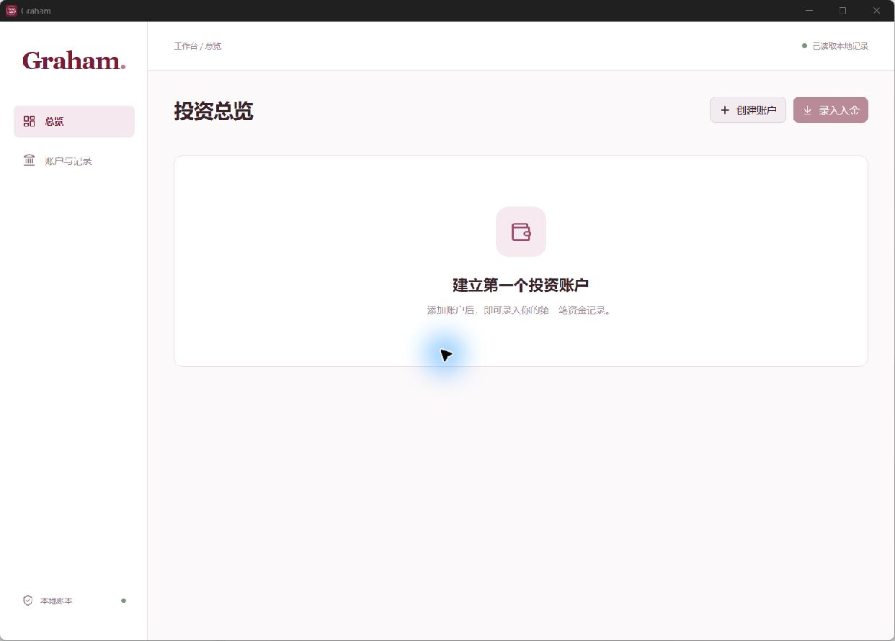

# Graham

Graham 是一款开源的中文 Windows 个人投资账本，用于记录和分析 A 股、港股与美股投资。它将多账户的现金、交易、持仓和分红保存在本机，结合市场行情展示资产估值与投资表现。

当前源码版本：**0.1.0**，首次公开源码预览版。项目处于早期开发阶段，目前主要支持 **Windows x64**。功能与限制见 [v0.1.0 发布说明](docs/releases/v0.1.0.md)。

[安装与使用](#安装与使用) · [开发与构建](#开发与构建) · [当前限制](#当前限制) · [MIT 许可证](LICENSE)

## 界面预览

以下为较早版本的账本界面截图，使用合成验收数据，不代表真实账户或资金。当前版本的界面与功能可能有所不同。

**投资总览与示例记录**



<details>
<summary>查看首次使用时的空账本界面</summary>



</details>

## 功能

| 功能 | 说明 |
| --- | --- |
| 多账户与多币种 | 分账户记账，查看合并总览，支持 CNY、HKD 和 USD |
| 交易与成本 | 登记股票、ETF 买卖及税费，按移动加权平均成本核算已实现和未实现盈亏 |
| 现金与分红 | 登记入金、出金、内部转账、换汇，以及待到账和已到账分红 |
| 期初建账 | 在历史交易不完整时，以核对后的持仓与现金快照建立起点 |
| CSV 导入 | 预览、校验并导入统一格式的账户记录，支持重复检查和批次撤回 |
| 行情与估值 | 获取 A 股、港股、美股行情和汇率，保留来源、报价时间与缓存状态 |
| 今日与累计收益 | 按市场、账户和原币查看今日盈亏、已实现盈亏、未实现盈亏及税后分红，支持清仓证券明细 |
| 投资表现与组合分析 | 查看时间加权收益率、资金加权收益率，以及市场、币种、行业和证券分布与贡献 |
| 记录维护与备份 | 修改、作废和恢复记录，查看修改历史，导出密码加密备份并恢复账本 |

## 安装与使用

### Windows 安装包

`v0.1.0` 以源码 Pre-release 形式发布，未附带 Windows 安装包。可下载 Release 自动提供的源码归档，并按下文构建。

1. 前往 [GitHub Releases](https://github.com/tallmye315/Graham/releases)，查看是否已有公开安装包；若尚未发布，请按下文从源码构建。
2. 下载对应版本的 `Graham_<版本>_x64-setup.exe`，运行安装程序，按提示完成当前用户安装。
3. 从桌面或开始菜单打开 Graham，创建投资账户后，手动登记记录或导入统一格式 CSV。

安装包内置 Python 行情运行时，使用安装版无需另行安装 Python、Node.js 或 Rust。获取新行情需要联网；已有记录和缓存可在本地查看。

### 初次建账

- 如果交易历史完整，按实际发生的资金流和买卖记录录入。
- 如果历史记录不完整，可先建立期初快照，再录入起点之后的记录，避免与期初持仓重复计算。
- 券商原始导出文件需要先整理成 [Graham 统一 CSV 格式](docs/product/unified-csv.md)；行情刷新不会自动同步券商交易。

### 升级

先从“备份与恢复”导出加密备份，保存正在编辑的内容并关闭 Graham，再运行新版安装包。账本独立保存在用户数据目录中；软件内的“版本与使用说明”可查看版本与使用提示。

## 数据与备份

- 账本保存在当前 Windows 用户的 `%LOCALAPPDATA%\com.graham.portfolio\` 目录中，主文件为 `ledger.sqlite3`，独立于源码和安装目录。行情缓存单独保存。
- **本机账本目前未加密**，没有应用登录密码。导出的 `.grahambak` 备份使用密码加密，软件不保存该密码；遗失后无法解密备份。
- 恢复备份会整体替换当前账本，恢复前会保存当前账本的加密副本；请先在软件中验证备份内容。
- 普通删除保留可恢复历史；“彻底删除”会清除对应记录与历史，无法在软件内撤回。独立保存的备份和快照不会随之删除。
- 行情刷新会向第三方数据源发送市场数据查询请求。账户记录保存在本机，当前没有云同步功能。

## 开发与构建

桌面端使用 **Tauri 2 / Rust**，界面使用 **React / TypeScript**、Tailwind CSS、shadcn/ui 和 ECharts，账本使用 **SQLite**。行情由内置 Python 进程接入 AKShare 和 yfinance。

### 开发环境

在 Windows x64 上准备：

- Node.js，版本需满足 [package.json](package.json) 中的 `engines` 要求：`^22.22.2 || ^24.15.0 || >=26.0.0`。
- Rust MSVC 工具链、C++ Build Tools 和 Windows SDK。
- Microsoft Edge WebView2 Runtime。
- Python 3.13，用于准备和验证内置行情运行时。

下载源码后，在项目根目录打开 PowerShell，执行：

```powershell
npm ci
python scripts/build-market-runtime.py
npm run desktop -- dev
```

首次准备运行时会联网下载由 `market/runtime-lock.json` 固定版本和 SHA256 的依赖。`npm run dev` 仅启动网页开发服务器，普通浏览器无法使用 Tauri 提供的本地账本功能；完整开发请使用上面的桌面启动命令。

### 检查与构建

```powershell
npm test
npm run check
cargo test -p graham-ledger --locked
python scripts/verify-market-runtime.py
npm run desktop -- build -- --locked
```

生成的 Windows 安装包位于 `target/release/bundle/nsis/`。`npm run build` 仅生成网页资源，桌面安装包需执行 Tauri 构建命令。

### 源码结构

| 目录 | 内容 |
| --- | --- |
| `src/` | React 界面、交互和前端测试 |
| `src-tauri/` | 桌面入口、原生命令与安装配置 |
| `crates/ledger/` | 账本、成本、收益计算及集成测试 |
| `market/` | 行情进程与依赖锁定文件 |
| `scripts/` | 运行时打包和验证脚本 |
| `assets/brand/` | Graham 品牌图形 |

## 当前限制

- 目前主要提供 Windows x64 支持，其他系统尚未提供安装包。
- 免费行情可能延时、缺失、限频或暂不可用；刷新频率不等于交易所实时报价。缺少必要数据时会显示不足状态，不将缺项当作零值。
- 今日证券收益按各市场交易日与原币计算，不同币种、交易日期和闲置现金不混合为一个证券收益率；盘中结果属于参考估算。
- 缺少期初记录、历史价格或汇率时，部分历史收益无法完整还原。拆股等公司行动尚无自动入账流程，需要自行核对。
- 券商专用导出格式尚未适配；当前支持手动登记与统一 CSV，不提供券商自动登录、交易同步或下单。
- 行业分类为本地业务归纳，未知项保留未分类，基金暂不穿透底层持仓。
- 当前采用手动升级，安装包尚未提供代码签名，Windows 可能显示未知发布者。
- 安装器采用内置 Python 运行时和 WebView2 离线安装方案；完全断网且未安装 Python / WebView2 的干净 Windows 环境，仍待独立验收。

市场数据与计算结果用于个人记录和核对，不构成投资建议。

## 文档与反馈

- [统一 CSV 格式](docs/product/unified-csv.md)
- [领域术语](GLOSSARY.md)
- [架构决策](docs/adr/)
- [开源源码发布检查清单](docs/open-source-release-checklist.md)
- [问题反馈与功能建议](https://github.com/tallmye315/Graham/issues)

反馈问题时，请说明软件版本、复现步骤及预期结果。示例文件和截图请使用虚构或已脱敏的数据，避免上传真实账本、券商原始导出、备份密码或账户资料。

## 许可证

Graham 采用 [MIT 许可证](LICENSE)，允许使用、修改及商业分发；分发时须保留版权声明和许可证全文。软件按现状提供，不作担保。Copyright © 2026 tallmye315。

第三方组件遵循各自的许可证，详见 [第三方声明](THIRD_PARTY_NOTICES.md)。行情数据的使用与再分发须遵守对应数据源的条款，MIT 许可证不授予第三方行情数据的额外使用权。
